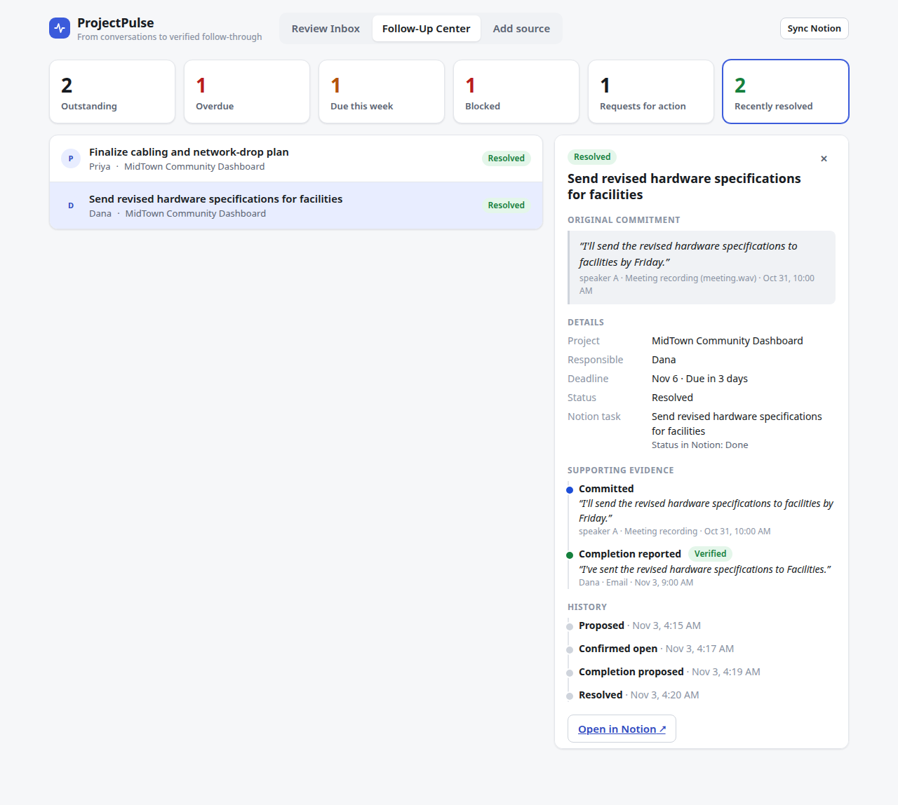

# ProjectPulse

**From conversations to verified follow-through.** ProjectPulse turns what your team says in meetings, emails and chat threads into tracked commitments, keeps your Notion records up to date, and shows what was done and what still needs doing. A person approves every change.



> Built for the Meta Global AI Developer Hackathon (Indie track) with **Muse Voice Transcribe** (meeting audio, one voice per speaker) and **Muse Spark** (finding commitments and matching them to your existing work), through the Meta Model API.

## Why ProjectPulse

People attend meetings, send emails, and reply in Slack threads. In all of them, people make commitments: *"I'll send the specs by Friday."* *"I'll have the checklist done by Wednesday."*

And still, things fall through the cracks. A promise is never written down, or it's written in the wrong place, or it's done and never recorded. So a project manager spends their week reconstructing what happened, working out what's still open, and chasing people for updates.

Meeting summarizers are everywhere now, but they stop at the summary. You get a paragraph and a list of action items that nobody copies into the tracker. Your Notion board still says "Not started" on a task that was finished yesterday, and still has no card for the thing someone promised this morning. **The gap isn't summarizing. It's following through.**

ProjectPulse closes that loop. It processes the conversation, finds the commitments, connects each one to the work you already track, notices later when evidence arrives that a commitment was met, and writes the result back to Notion once a person approves it. I built it because this is a problem my team has been trying to solve.

### Not another meeting summarizer

| | A meeting summarizer | ProjectPulse |
|---|---|---|
| **Output** | A summary to read | Updated records: tasks created, tasks closed, with the evidence attached |
| **Knows your existing tasks** | No | Yes. It matches each commitment to the right project and task, and won't create duplicates |
| **"I already sent it"** | Reported as fact | Recorded as a *claim*. An email with the attachment is *verified* evidence. Neither closes anything by itself |
| **A suggestion ("we could…")** | Often listed as an action item | Kept separate. It never becomes a task |
| **Who changes your records** | Nobody, or an unchecked automation | You do. Every change is shown with its quote, its reason and exactly what will change |
| **After the meeting** | Nothing | Later emails and updates are linked back to the original commitment, and the full history is kept |

## What it does

1. **Capture** a meeting recording, a transcript, an email, or pasted text (a Slack thread, for example).
2. **Understand** it. Speakers are identified from context, and commitments, requests, suggestions, progress, blockers and completion claims are extracted with the exact quote behind each.
3. **Reconcile** with existing work: project first, then task, so near-identical tasks in other projects are never mixed up.
4. **Review.** A person approves, edits or rejects each item.
5. **Close the loop.** Approved changes are written to Notion safely (re-checked against its current state, idempotent, retryable). The Follow-Up Center shows what is outstanding, overdue, blocked or resolved, and why.

The model interprets. The graph coordinates. The backend validates. The human resolves uncertainty. The system executes approved actions. See [`docs/graph-design.md`](docs/graph-design.md) for the workflow, and run `python scripts/explain_decisions.py` for the reasoning behind each design decision.

## Where it stands

- **Inputs today:** WAV recordings and pasted text (transcripts, emails, chat). Direct Zoom, Gmail and Slack integrations are future work.
- **Output today:** Notion. New tasks are created and completed tasks are marked done, each with its evidence. Linking a commitment to an existing task is tracked in ProjectPulse and does not change Notion.
- **Local use:** there is no sign-in. Run it on your own machine with your own keys.
- **Model output varies.** That is why a person reviews everything before it is applied.

## Built during the hackathon

The repository began with a one-line README. Every line of application code in it was written during the hackathon: the data model, the LangGraph workflow, the Notion integration, the API, the interface, the tests and the demo tooling. The git history shows this. The product specification (`Project Description.pdf`) describes what to build; the implementation is new work.

## Run it

Requirements: Python 3.12 with [uv](https://docs.astral.sh/uv/), Node 20+, PostgreSQL, a Meta Model API key and a Notion token.

```bash
cp .env.example .env            # then fill in MODEL_API_KEY, NOTION_TOKEN and the Notion database ids
createdb projectpulse

cd backend
uv sync
uv run python -m app.db         # create the schema
uv run python -m app.notion_sync

cd ../frontend
npm install
npm run build                   # the API serves the built UI

cd ../backend
uv run uvicorn app.api:app --port 8077
```

Open <http://localhost:8077>. (For UI development run `npm run dev` in `frontend/`; it proxies `/api` to port 8077.)

### Notion setup

Two databases: **Tasks** (`Name`, `Owner`, `Due`, `Status` with a `Done` option, `Project`, `Evidence`, and a `Project Link` relation to Projects) and **Projects** (`Name`, `Aliases`, `Client`). Project aliases are how "the dashboard install" in a meeting finds the right project.

### Tests

```bash
cd backend
uv run pytest            # fast suite: real Postgres, fake model and Notion
uv run pytest -m live    # calls the real Meta and Notion APIs (costs tokens)
```

### Demo

[`docs/demo-script.md`](docs/demo-script.md) has the three-minute walkthrough. `scripts/reset_demo.py` restores the demo state between takes.

## Data

The demo uses **synthetic** data: a scripted meeting rendered with text-to-speech voices (`scripts/make_meeting_audio.py`), and a test Notion workspace. Real meetings would be sent to the Meta Model API, so check what your organization allows before using real recordings.
