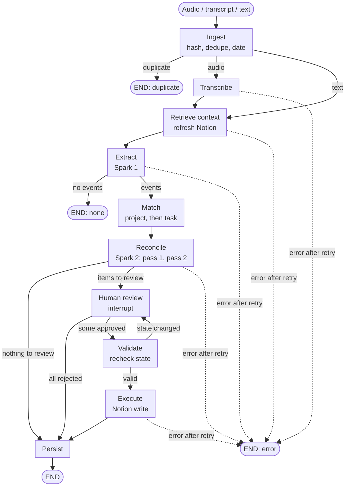

# ProjectPulse: LangGraph workflow design

Principle: **the model interprets, the graph coordinates, the backend validates, the human resolves uncertainty, the system executes approved actions.**

Every design choice below has a recorded rationale. Run `python scripts/explain_decisions.py` to read them (`--id D5`, `--grep notion`).

## Flow

How to read it:

- Solid arrows are the normal path. Dashed arrows are failures.
- **Three places the graph stops early:** a duplicate source, no events found, or an error.
- **One loop:** `Validate` can send the run back to `Human review`. That happens when someone edited the Notion page after the sync, so the action is no longer safe. A new review item is created and nothing is written.
- **Two ways to reach `Persist` without writing to Notion:** nothing needed review, or the human rejected everything.
- Text input skips `Transcribe`. Everything else is shared with audio.

Transcripts and emails use the same graph with `transcribe` skipped. The email work-relevance gate from the original sketch is deferred; the audio path comes first.

## Runs and threads

- One run per source. `thread_id = source-<id>`.
- A meeting and a later email are separate runs. The email finds earlier commitments through Postgres, not through graph state.
- Graph state holds ids only. Postgres is the source of truth.
- Events and review items are written to the DB during `extract` and `reconcile`, so the Review Inbox is populated while the graph is paused.
- LangGraph re-runs the interrupted node from its start on resume, so `human_review` does no work before `interrupt()`.

## Nodes

| Node | Model | Job |
|---|---|---|
| ingest | none | Hash the raw input first, dedupe, store, record `occurred_at` and timezone (required for audio). |
| transcribe | Muse Voice Transcribe | Diarized turns. Audio only. WAV, mono 16-bit, 16 or 24 kHz, 10 minutes and 32 MB maximum. |
| retrieve_context | none | Refresh the Notion snapshot, then load people, projects with aliases, open tasks and open commitments. |
| extract | Muse Spark call 1 | Typed events, speaker names inferred from context, meeting-level project, deadlines. |
| match | none | Project first (meeting project plus per-event hint), then rank that project's tasks by owner and title similarity, top 3. |
| reconcile | Muse Spark call 2 | Two passes. Pass 1: commitments and requests. Pass 2: claims, progress, blockers and contradictions, against Notion tasks plus pass 1's results. |
| human_review | none | One `interrupt()` per run with all open review items. |
| validate | none | Re-check the approved action against current state, including the Notion page's `last_edited_time`. |
| execute | none | Idempotent Notion write. A no-op for DB-only actions such as linking. |
| persist | none | State transitions, evidence links, audit rows. |

## What needs a human

| Event outcome | Review? | Effect on approval |
|---|---|---|
| Commitment matching a task | Yes, `task_match` | Links the commitment to the task. DB only. |
| Commitment with no match | Yes | Creates a Notion task. |
| Suggestion | Yes, `suggestion` | Never a commitment unless promoted. |
| Completion claim | Yes, `potential_completion` | Notion: Status to Done, plus an Evidence note. |
| Progress or blocker | No | Saved as `claimed` evidence. Never resolves anything. |
| Contradiction, ambiguous owner or deadline, conflicting deadline | Yes | Review item. |
| Claim with no matching task | Yes, `uncertain_extraction` | Nothing written. |

Evidence strength: a spoken claim is `claimed`. An email with an artifact is `verified`. Both only reach `resolution_proposed`; a human still approves.

## Early exits and failure paths

- Duplicate source: end after ingest.
- No events extracted: end after extract, with an audit row.
- Nothing needs review: go straight to persist.
- All items rejected: skip execute, persist the rejections.
- Validate fails: create a new review item ("Notion changed since sync"). Nothing is written.
- Spark or Notion error: one retry, then stop with a recorded error.

## Safety

- `validate` re-fetches the page and compares `last_edited_time` with the snapshot. A human edit since the sync fails validation; it is never overwritten.
- `execute` inserts an `executions` row with a unique idempotency key (`sha(commitment_id, page_id, action, target)`) and `ON CONFLICT DO NOTHING`. A retry of a finished action is a no-op.
- Model output is validated, not trusted: excerpts must appear verbatim in the transcript, and deadlines are sanity-checked (not before the source date, within a year, weekday agrees with the stated weekday).

## Across runs

- Run 1 (meeting) creates commitments. Run 2 (later email or text) finds them through the DB and can propose resolution.
- The Follow-Up Center is a read-only query over commitments. Overdue is computed at read time, so no scheduler is needed.
- Out of scope: a task marked Done directly in Notion does not close its commitment.

## Demo trace

Meeting date Oct 31 2026 (a Saturday).

| Speaker said | Expected result |
|---|---|
| Dana: "I'll send the revised hardware specifications to Facilities by Friday" | Project MidTown. Matches "Send revised hardware specifications for facilities" (Dana, Nov 6). The Harbor kiosks task is excluded by project. Review: approve link. |
| Sam: "We could consider contacting the vendor" | Suggestion. Review item, never a task. |
| Priya: "I sent the cabling plan to Facilities yesterday" | Completion claim. The MidTown cabling task matches, not the Eastside one. Review: potential completion, `claimed`. |
| Marcus: "halfway through, blocked on second-floor access" | Progress plus blocker on the display mounting task. Evidence only, no review. |
| Dana asks Alex; Alex: "I'll have it done by then" | Request plus commitment, matched to the NUC checklist. "Before next Wednesday" is `inferred`; a mismatch with Notion's Nov 4 becomes a review item. |
