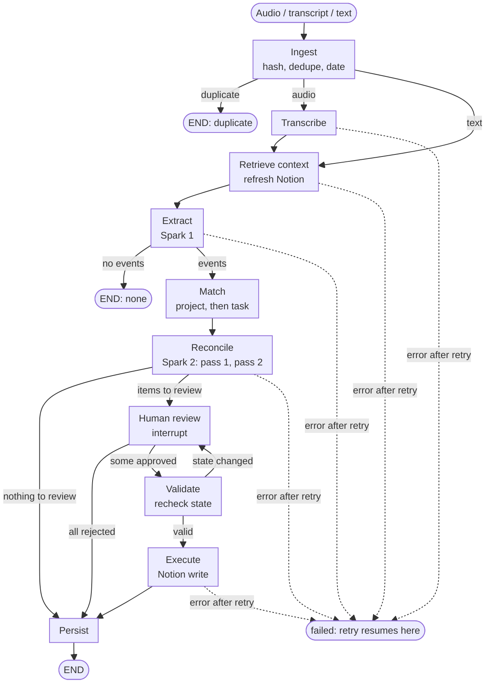

# ProjectPulse: LangGraph workflow design

Principle: **the model interprets, the graph coordinates, the backend validates, the human resolves uncertainty, the system executes approved actions.**

Every design choice below has a recorded rationale. Run `python scripts/explain_decisions.py` to read them (`--id D5`, `--grep notion`).

## Flow

How to read it:

- Solid arrows are the normal path. Dashed arrows are failures.
- **Three places the graph stops early:** a duplicate source, no events found, or an error.
- **One loop:** `Validate` can send the run back to `Human review`. That happens when someone edited the Notion page after the sync, so the action is no longer safe. A new review item is created and nothing is written.
- **Two ways to reach `Persist` without writing to Notion:** nothing needed review, or the human rejected everything.
- Text input skips `Transcribe`. Everything else is shared with audio.

Transcripts and emails use the same graph with `transcribe` skipped. The email work-relevance gate from the original sketch is deferred; the audio path comes first.

## Runs and threads

- One run per source. `thread_id = source-<id>`.
- A meeting and a later email are separate runs. The email finds earlier commitments through Postgres, not through graph state.
- Graph state holds ids only. Postgres is the source of truth.
- Events and review items are written to the DB during `extract` and `reconcile`, so the Review Inbox is populated while the graph is paused.
- LangGraph re-runs the interrupted node from its start on resume, so `human_review` does no work before `interrupt()`.

## Nodes

| Node | Model | Job |
|---|---|---|
| ingest | none | Hash the raw input first, dedupe, store, record `occurred_at` and timezone (required for audio). |
| transcribe | Muse Voice Transcribe | Diarized turns. Audio only. WAV, mono 16-bit, 16 or 24 kHz, 10 minutes and 32 MB maximum. |
| retrieve_context | none | Refresh the Notion snapshot, then load people, projects with aliases, open tasks and open commitments. |
| extract | Muse Spark call 1 | Typed events, speaker names inferred from context, meeting-level project, deadlines. |
| match | none | Project first (meeting project plus per-event hint), then rank that project's tasks by owner and title similarity, top 3. |
| reconcile | Muse Spark call 2 | Two passes. Pass 1: commitments and requests. Pass 2: claims, progress, blockers and contradictions, against Notion tasks plus pass 1's results. |
| human_review | none | One `interrupt()` per run with all open review items. |
| validate | none | Re-check the approved action against current state, including the Notion page's `last_edited_time`. |
| execute | none | Idempotent Notion write. A no-op for DB-only actions such as linking. |
| persist | none | State transitions, evidence links, audit rows. |

## What needs a human

| Event outcome | Review? | Effect on approval |
|---|---|---|
| Commitment matching a task | Yes, `task_match` | Links the commitment to the task. DB only. |
| Commitment with no match | Yes | Creates a Notion task. |
| Suggestion | Yes, `suggestion` | Never a commitment unless promoted. |
| Completion claim | Yes, `potential_completion` | Notion: Status to Done, plus an Evidence note. |
| Progress or blocker | No | Saved as `claimed` evidence. Never resolves anything. |
| Contradiction, ambiguous owner or deadline, conflicting deadline | Yes | Review item. |
| Claim with no matching task | Yes, `uncertain_extraction` | Nothing written. |

Evidence strength: a spoken claim is `claimed`. An email with an artifact is `verified`. Both only reach `resolution_proposed`; a human still approves.

## What the UI sees

The graph is driven through `app/runner.py`. Each function is something a person does.

| Person does | Call | Result |
|---|---|---|
| Uploads a recording or pastes text | `start_run` / `stream_start` | A run starts. `stream_start` yields one event per node for a live progress view. |
| Looks at a run | `get_run`, `list_runs` | Status, current node, a message, and (when paused) which items still lack a decision and whether Apply is allowed. |
| Approves, rejects or edits an item | `submit_decision` | Saved immediately. Can be changed until Apply. |
| Presses Apply | `apply_run` / `stream_apply` | Refused until every item has a decision, and says which are missing. Otherwise resumes the graph. |
| Retries a failure | `retry_run` | Resumes from the checkpoint. Only valid for a `failed` run. |

Run status in the `runs` table:

| Status | Meaning | What the UI shows |
|---|---|---|
| `running` | The graph is executing `current_node`. | Progress through the nodes. |
| `waiting_for_review` | Paused at the interrupt. No process is held. | The Review Inbox for this run, with Apply enabled once every item has a decision. |
| `completed` | Decisions applied. | The resulting Follow-Up Center state. |
| `duplicate` | The same source was already processed. | "Already processed", with a pointer to the earlier run. |
| `no_events` | Nothing actionable was found. | "Nothing to follow up." |
| `failed` | A node failed twice. | The error message and a Retry button. |

The graph stops in exactly two ways: a terminal status, or the pause at `waiting_for_review`. A paused run survives a closed browser or a restarted server, because its state is in Postgres.

## Review item actions

| Item kind | Proposed action | Approve | Reject | Edit can change |
|---|---|---|---|---|
| `task_match` / `ambiguous_owner_or_deadline` / `uncertain_extraction` with a link | `link_task` | Commitment becomes open, linked to the task. No Notion write. | Commitment rejected. | owner, due, which task |
| Commitment with no match | `create_task` | Notion task created, commitment open. | Commitment rejected. | title, owner, due |
| `potential_completion` | `resolve_task` | Notion task set to Done with an evidence note, commitment resolved. | Commitment returns to open. | nothing |
| `suggestion`, `conflict`, `possible_duplicate`, other | none | Acknowledged. | Dismissed. | nothing |

If an approved action cannot proceed (the Notion task changed, was completed, or a similar task already exists), the item is resolved and a fresh `conflict` item replaces it, carrying the reason.

## Early exits and failure paths

- Duplicate source: end after ingest.
- No events extracted: end after extract, with an audit row.
- Nothing needs review: go straight to persist.
- All items rejected: skip execute, persist the rejections.
- Validate fails: create a new review item ("Notion changed since sync"). Nothing is written.
- Spark or Notion error: one retry, then the run is marked `failed` and the checkpoint is kept before the failing node. Retry resumes from there; idempotency keys make a repeated write harmless.

## Safety

- `validate` re-fetches the page and compares `last_edited_time` with the snapshot. A human edit since the sync fails validation; it is never overwritten.
- `execute` inserts an `executions` row with a unique idempotency key (`sha(commitment_id, page_id, action, target)`) and `ON CONFLICT DO NOTHING`. A retry of a finished action is a no-op.
- Model output is validated, not trusted: excerpts must appear verbatim in the transcript, and deadlines are sanity-checked (not before the source date, within a year, weekday agrees with the stated weekday).

## Across runs

- Run 1 (meeting) creates commitments. Run 2 (later email or text) finds them through the DB and can propose resolution.
- The Follow-Up Center is a read-only query over commitments. Overdue is computed at read time, so no scheduler is needed.
- Out of scope: a task marked Done directly in Notion does not close its commitment.

## Demo trace

The demo is the University Circle Dashboard project in Notion, with four tasks: configure the NUC (Adam), deliver the display (John), drill the mounting points (Matthew) and install the display (Alex, due 2026-11-14). The evidence is an email from John (Nov 12) and a meeting on Nov 13 with John, Adam and Matthew. The meeting audio is generated by `scripts/make_meeting_audio.py`: three voices, written the way people talk. Everyone is addressed by name, so Spark can identify them from context.

| Source | Expected result |
|---|---|
| **Email from John**, "I picked up the digital display and delivered it", `delivery-receipt.pdf` attached | Completion of "Pick up and deliver the digital display to the site", marked **verified** (attachment). Approved, the task goes to Done. |
| John: "Adam, can you give us an update on the NUC?" | A question, not a commitment and not a request for work. No event. |
| Adam: "I've finished configuring the NUC… tested the dashboard… ready for installation" | Completion claim matched to "Configure and test NUC for dashboard". Review: possible completion, **claimed**. |
| Matthew: "I've drilled the mounting holes at the agreed locations" | Completion claim matched to "Drill mounting points for digital display". Review: possible completion, **claimed**. |
| John: "So the display has been delivered…" | Restates work already Done in Notion, so there is nothing left to do and no card. |
| John: "Alex is still scheduled to install the display tomorrow, November 14" | Matches Alex's open install task. It is not completed, so it stays outstanding, and no duplicate installation task is created. |
